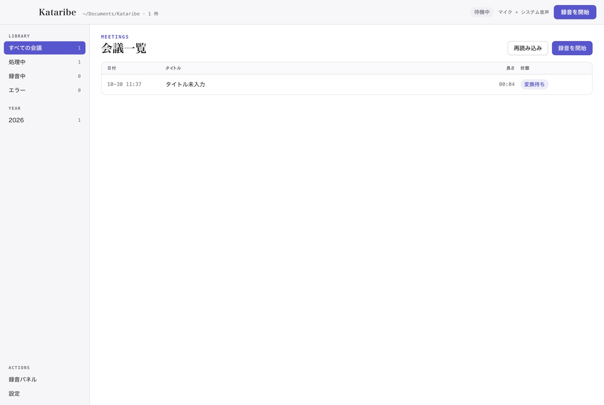
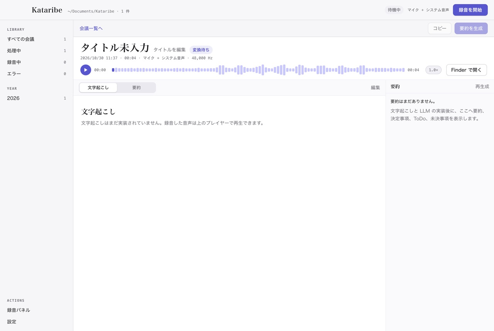
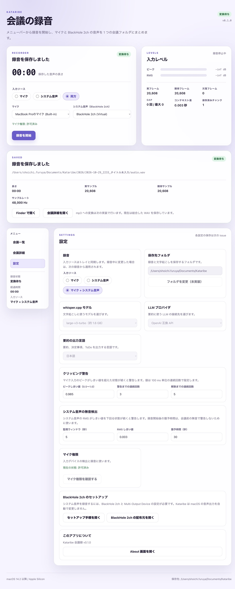

# Kataribe（語り部）

Kataribe は、macOS で会議音声を録音し、端末内で文字起こしし、任意の LLM で要約と ToDo を Markdown にまとめるデスクトップアプリです。
Zoom や Google Meet の相手の声と自分の声を 1 本の mp3 に録音し、会議後に mp3、文字起こし、要約、ToDo を 1 つのフォルダに保存します。

## 名前について

Kataribe（語り部）は、その場で聞いた出来事を記憶し、後の人に語り継ぐ役を表します。
録音、文字起こし、要約の 3 工程をそのまま表す名前です。
同名のツールと区別するため、配布時は「Kataribe 会議録」と併記します。
GitHub のリポジトリ名もアプリ名と同じ `kataribe` にします。

## ステータス

開発中です。
アプリ基盤、録音中核、メニューバー、会議一覧、会議詳細、設定、デバイス消失と権限拒否の処理は実装済みです。
M0 のシステム音声検証は完了しています。
会議一覧、会議詳細の波形プレイヤー、設定画面のタブと設定値の保存は実装済みです。
録音停止後の mp3 変換、16 kHz WAV の生成、whisper.cpp による文字起こし、whisper モデルのダウンロード、API キーの Keychain 保存、LLM による要約を実装済みです。
OpenAI の文字起こし API をローカルの whisper.cpp と切り替えて使えます。要約の前に相槌と擬音を除く前処理にも対応しています。
文字起こしの翻訳、話者分離（2〜10 人）、全文検索、保存先の変更、会議タイトルの編集、Multi-Output Device の自動作成も実装済みです。
mp3 のビットレート設定、会議ごとの要約言語、検索結果からの音声ジャンプ、処理速度の学習、既存音声の取り込み、要約プロンプトの編集にも対応しています。
UI の表示言語は日本語と英語から選べます。
全会議の ToDo 一覧と、要約の再生成前の警告にも対応しています。
GitHub Releases で署名なしの開発版 DMG（arm64）を配布しています。署名と公証は行いません。
この README の初期セットアップ手順は、録音機能を使う利用者向けです。

## ドキュメント

- [PRD](docs/prd/kataribe.md)
- [ADR 一覧](docs/adr/)
- [Issue 一覧](docs/issues/)
- [変更履歴](CHANGES.md)
- [録音のリリース回帰テスト](docs/testing/recording-regression.md)
- [M0 システム音声検証](docs/m0/0003-system-audio/README.md)

主な ADR:

- [ADR-0001: Electron + TypeScript + React + Vite](docs/adr/0001-electron-typescript-react-vite.md)
- [ADR-0002: Web Audio 録音とチャンク](docs/adr/0002-web-audio-recording-and-chunks.md)
- [ADR-0003: システム音声は BlackHole 経由](docs/adr/0003-system-audio-virtual-device.md)
- [ADR-0012: メニューバーとメインウィンドウ](docs/adr/0012-menu-bar-and-main-window.md)
- [ADR-0014: DMG 配布と署名、公証（ADR-0017 で置き換え）](docs/adr/0014-distribution-dmg-notarization.md)
- [ADR-0017: 配布は行わず、ローカルビルドのみを使う（ADR-0019 で改訂）](docs/adr/0017-local-build-only.md)
- [ADR-0018: Multi-Output Device は利用者の明示操作で自動作成する](docs/adr/0018-multi-output-auto-creation.md)
- [ADR-0019: タグ作成時に署名なしの開発版 DMG を GitHub Releases で配布する](docs/adr/0019-unsigned-dmg-releases.md)

## 動作環境

- macOS 14.2 Sonoma 以降を目標
- Apple Silicon
- 検証済み: macOS 26.7.1 (25G241)、arm64
- Intel Mac は対象外
- BlackHole 2ch 0.7.1 で検証済み
- 開発には Node.js 24.21.0 以降と npm が必要

macOS 14.2 以降のすべての版で動作を保証するものではありません。
検証は macOS 26.7.1 で行っています。

## 初期セットアップ

Kataribe でシステム音声を録音するには、BlackHole 2ch と Multi-Output Device の設定が必要です。
Kataribe は macOS の音声出力を自動で変更しません。

### 1. BlackHole 2ch をインストールする

1. [BlackHole の公式配布元](https://existential.audio/blackhole/) から BlackHole 2ch をダウンロードします。
2. インストーラを実行します。管理者権限が必要です。
3. インストール後に `coreaudiod` を再起動するか、Mac を再起動します。

BlackHole 2ch は GPLv3 のソフトウェアです。
Kataribe は BlackHole 2ch を同梱せず、再配布しません。

### 2. Multi-Output Device を作る

Kataribe の「設定 > 録音 > Multi-Output Device」から自動作成できます。
出力デバイスを選び、「自動作成して出力に設定」を押してください。
macOS の音声出力が「Kataribe Multi-Output」に切り替わります。

手動で作る場合は次の手順です。

1. `Audio MIDI Setup` を開きます。
2. 左下の `+` から `Create Multi-Output Device` を選びます。
3. スピーカーまたはヘッドホンと `BlackHole 2ch` にチェックを入れます。
4. 主デバイス（一覧の先頭）をスピーカーまたはヘッドホンにします。
5. Bluetooth 出力で音が飛ぶ場合は、BlackHole 2ch の `Drift Correction` を有効にします。

Multi-Output Device では macOS の音量キーが効かない場合があります。
音量はスピーカー、ヘッドホン、BlackHole 側で調整してください。

### 3. macOS の音声出力を Multi-Output Device にする

1. `System Settings` の `Sound` を開きます。
2. `Output` で作成した Multi-Output Device を選びます。

BlackHole 2ch を単体で出力に選ぶと、Mac から音が聞こえません。
必ず Multi-Output Device を選んでください。

### 4. Kataribe の入力を設定する

Kataribe の設定画面で、入力を次のようにします。

- システム音声: `BlackHole 2ch`
- マイク: Mac の内蔵マイクまたは USB マイク

システム音声だけを録音する場合は、マイクを使わなくてもかまいません。
マイクとシステム音声の両方を録音する場合は、両方を設定します。

### 5. テスト録音をする

1. 会議アプリまたは音楽プレイヤーで音を再生します。
2. Kataribe で 10 秒程度の録音を開始します。
3. 入力レベルが動くことを確認します。
4. 録音を停止し、mp3 に相手の声と自分の声が入っていることを確認します。

システム音声の入力レベルが動かない場合は、[トラブルシューティング](#トラブルシューティング) を確認してください。

## Bluetooth を使う場合

Bluetooth ヘッドホンのマイクを入力に使うと、macOS は HFP に切り替えます。
AirPods では HFP は 24 kHz モノラルになり、会議音声や音楽の品質が下がります。
Kataribe はこの切り替えを防げません。

推奨する組み合わせは次のとおりです。

| 項目 | 推奨 |
| --- | --- |
| 出力 | AirPods などの Bluetooth ヘッドホン（A2DP） |
| マイク入力 | Mac の内蔵マイクまたは USB マイク |
| Multi-Output Device | Bluetooth 出力 + BlackHole 2ch |
| macOS の音声出力 | 上記の Multi-Output Device |
| macOS の入力 | 内蔵マイクまたは USB マイク |
| 会議アプリのマイク | 内蔵マイクまたは USB マイク |
| Kataribe のシステム音声入力 | BlackHole 2ch |
| Kataribe のマイク入力 | 内蔵マイクまたは USB マイク |

Bluetooth ヘッドホンを入力と出力の両方に使わないでください。
Bluetooth 出力を使うときは、接続した状態で Multi-Output Device を作成します。
切断した場合は、再接続して macOS の出力を選び直してください。
Bluetooth 出力には遅延があります。

## 起動方法

### 配布版

[GitHub Releases](https://github.com/sfuruya0612/kataribe/releases) に署名なしの開発版 DMG（arm64）を置いています。
DMG は `v<package.json のバージョン>` タグを push すると自動作成されます。
署名と公証を行っていないため、macOS の Gatekeeper によって起動をブロックされる場合があります。
その場合は Applications にコピーしたアプリを Finder で右クリックして「開く」を選ぶか、システム設定の「プライバシーとセキュリティ」から許可してください。
動作環境は macOS 14.2 以降の Apple Silicon（arm64）です。
DMG と一緒に添付している `.sha256` ファイルで、ダウンロードした DMG が正しく取得できたか確認できます。
初回の録音時または入力デバイスの検出時に、マイク権限のダイアログが出ます。

### 開発版

必要なもの:

- Node.js 24.21.0 以降
- npm
- mise（任意。Node.js の版を固定して npm を実行する場合）

mise を使う場合は、リポジトリ直下で次を実行します。

```sh
mise install
mise run install
mise run dev
```

`mise run` から npm スクリプトを実行できます。

```sh
mise run build
mise run typecheck
mise run test
mise run check
mise run package
mise run verify
mise run npm -- run <script>
```

`mise run npm -- ...` は、mise が管理する Node.js の npm に引数をそのまま渡します。

npm を直接使う場合:

```sh
npm install
npm run dev
```

ビルドと確認:

```sh
npm run binaries
npm run typecheck
npm test
npm run build
npm run smoke
npm run test:window
npm run package
npm run verify:mac
```

`npm run binaries` は、同梱する whisper-cli と ffmpeg を `resources/bin/<arch>/` にビルドする。
リポジトリにビルド済みの arm64 バイナリがある場合、このコマンドは不要です。
`npm run package` は署名なしの `release/mac-arm64/Kataribe.app` を作る。
`npm run verify:mac` は、`Info.plist`、entitlement、同梱物、アプリサイズを検査する。
`npm run test:window` は、メインウィンドウを閉じてもアプリが終了せず、ウィンドウが非表示になることを確認する。
署名と公証は行いません（[ADR-0019](docs/adr/0019-unsigned-dmg-releases.md)）。

起動するとメニューバーにマイクのアイコンが表示されます。

- アイコンを左クリックすると、録音を開始または停止します。
- アイコンを右クリックすると、状態、経過時間、録音の開始と停止、入力ソース、メインウィンドウを開く項目、終了のメニューが表示されます。
- メインウィンドウを閉じてもアプリは終了せず、メニューバーに残ります。
- 2 つ目の Kataribe を起動すると、既存のウィンドウが前面に表示されます。

開発版の録音パネルでは、次の流れを確認できます。

1. 入力ソースにマイク、システム音声、両方のいずれかを選びます。
2. マイクと BlackHole 2ch の入力デバイスを選びます。
3. 録音を開始し、経過時間、ピーク、RMS、実フレーム数を確認します。
4. 録音を停止すると、`~/Documents/Kataribe/YYYY/YYYY-MM-DD_HHMM_タイトル未入力/` に `audio.mp3`、`transcript.md`、`meta.json` を保存します。





録音中の音声は 10 秒ごとに一時ディレクトリへ WAV チャンクとして書き出します。
停止時にチャンクを結合し、mp3 (64 kbps、モノラル、44.1 kHz)を生成します。文字起こし前の強調が OFF のときは、文字起こし用の 16 kHz WAV も生成します。
mp3 と、生成した場合は 16 kHz WAV の生成が成功したら、結合した中間 WAV を削除します。

録音停止後、選択中の文字起こしエンジンで文字起こしを自動的に開始します。既定はローカルの whisper.cpp です。
文字起こしの進捗と予想残り時間は会議詳細に表示し、途中で中断できます。
最後まで完了しなかった場合は、それまでの結果を部分的な `transcript.md` として保存します。
進捗が止まった場合は同じモデルで 1 回だけ自動再開し、それでも完了しない場合はより小さいモデルでの再実行を案内します。

「設定 > 文字起こし」で OpenAI の文字起こし API を選ぶと、録音停止後に音声を送る前の確認ダイアログが出ます。
送信を承認したときだけ音声を OpenAI に送り、承認しなかった場合はローカルの whisper.cpp で続けます。
OpenAI のモデルは `whisper-1` を既定とし、`gpt-4o-transcribe` と `gpt-4o-mini-transcribe` も選べます。
`whisper-1` 以外のモデルは区間のタイムスタンプを返さないため、文字起こしの時刻は分割した区間の単位になります。

「設定 > 録音 > 話者分離」を有効にすると、sherpa-onnx で 2〜10 人の話者を推定し、文字起こしの行頭に `話者A` から `話者J` のラベルを付けます。
話者数は自動検出を既定にし、2〜10 人を指定できます。初回は約 46 MB の話者分離モデルをダウンロードします。
音声強調の実装後は、同じ音声、同じ話者分離設定、同じ強調の有無、同じ強調モデル、同じ強調設定で再文字起こしするときは、初回の話者分離結果を再利用し、クラスタ ID に付けた話者名を保持します。raw では PCM 由来と mp3 由来の 16 kHz WAV の差を同一視します。
会議詳細の「話者名を編集」から話者名を変更でき、文字起こしと、話者名を保持している翻訳に反映されます。
話者ラベルは推定であり、声質が近い場合や重なり発話では誤ることがあります。文字起こしは会議詳細から編集できます。

多言語が混在する音声では、whisper.cpp のファイル単位の言語判定を使うため、主言語に引っ張られる場合があります。
文字起こしの翻訳は、会議詳細の「日本語訳」「English 訳」から実行します。
送信前に内容と送信先を確認し、翻訳結果は `transcript.ja.md` または `transcript.en.md` に保存します。
原文の `transcript.md` は変更しません。

録音中にアプリが異常終了した場合は、次回起動時に録音パネルへ復旧できる録音が表示されます。
録音中に BlackHole 2ch が消えた場合は、録音を停止してチャンクを保存します。
録音中にマイクだけが消えた場合は、システム音声の録音を続け、警告を表示します。
入力ソースは自動で切り替えません。
デバイスの消失と権限拒否の時刻と種類は `meta.json` に記録します。

会議一覧と会議詳細の波形プレイヤーは実装済みです。
会議一覧の「音声を取り込む」から既存の mp3 / wav を文字起こしできます。
会議一覧の各行から Pin 止めと削除ができます。Pin 止めした会議は一覧の先頭に表示されます。削除は確認ダイアログを出し、音声、文字起こし、要約、メタデータをまとめて削除します。
サイドバーは年 -> 月の階層で会議を絞り込めます。
会議一覧上部の検索欄から、タイトル、文字起こし、翻訳、要約を横断検索できます。検索結果にタイムスタンプがある場合は、音声プレイヤーの該当位置から再生できます。
会議詳細のタイトル横の「タイトルを編集」からタイトルを変更できます。タイトルを変更すると会議フォルダ名と Markdown の front matter も更新します。
タイトルが未入力の会議は、要約生成時に LLM が内容からタイトルを付けます。
会議詳細の要約ペインから、その会議だけの要約言語を日本語 / English に上書きできます。
サイドバーの「ToDo 一覧」から、全会議の要約にある ToDo を会議名と日付付きで確認できます。未完了、完了、すべてを切り替えられ、チェックを切り替えると各会議の `summary.md` のチェックボックスに保存されます。会議名から会議詳細を開けます。
既存の要約がある会議で要約を再生成すると、送信確認ダイアログに、既存の要約を上書きすることと、ToDo の完了状態を引き継がないことを表示します。
設定画面の入力ソースは、メニューバーと録音パネルに同期します。
保存先は「設定 > 一般」から変更できます。既存の会議フォルダは移動しません。
保存先を iCloud Drive などの同期フォルダにすると、最終成果物と処理中の `audio.wav` が端末外に同期されます。
入力ソース、保存先、モデル、文字起こしエンジン、OpenAI のモデル、話者分離、LLM プロファイル（ID、Provider、エンドポイント URL、モデル、既定のプロファイル）、要約前の相槌と擬音の除去、出力言語、UI の言語、クリッピング警告、無音検出の設定は `~/Library/Application Support/Kataribe/settings.json` に保存します。
会議一覧と全文検索の索引は `~/Library/Application Support/Kataribe/index/` の SQLite に保存し、会議フォルダから再構築できます。
API キーは `~/Library/Application Support/Kataribe/config.json` に暗号化して保存します。
BlackHole 2ch のセットアップ手順は、設定画面から README を開いて確認できます。

## 初回起動後の設定

設定画面は「一般」「録音」「文字起こし」「要約」のタブで構成しています。
モデル、LLM プロファイル、出力言語、クリッピング警告、無音検出の設定を保存します。



画像は UI の言語設定を追加する前のものです。現在の設定画面には「一般」タブに UI の言語の選択があります。

1. 「一般」タブで保存先、外観（システム / ライト / ダーク）、UI の言語（日本語 / English）を変更できます。外観の既定はシステムで、macOS の設定に追従します。UI の言語の既定は日本語で、変更すると画面、メニューバー、アプリケーションメニュー、確認ダイアログ、エラーメッセージにすぐ反映されます。保存先の変更後、既存の会議は新しい一覧に表示されません。
2. 「録音」タブで話者分離の有無、話者数、話者分離モデルのダウンロード、mp3 のビットレート（64 / 128 kbps）、Multi-Output Device の自動作成を設定できます。
3. 「文字起こし」タブで文字起こしエンジンを選びます。既定はローカルの whisper.cpp です。ローカルを選んだ場合はモデルをダウンロードします。large-v3-turbo は約 1.6 GB です。ダウンロードは `.part` ファイルに書き、HTTP Range で再開できます。SHA-256 を照合してから保存します。用語集を initial prompt として指定できます。OpenAI API を選んだ場合は ChatGPT のプロファイルとモデルを選びます。API キーは「要約」タブの ChatGPT プロファイルに保存します。
4. 「要約」タブで LLM プロファイルを追加します。ID（一意の名前）、Provider、エンドポイント URL、モデル、API キーを 1 つの組み合わせとして保存し、ID ごとに保持します。プリセットは Claude、ChatGPT、Gemini、Ollama Cloud、Fireworks AI、カスタムです。プロファイルごとに API キーを保存できます。要約プロンプトと、要約の前に相槌と擬音を除くかどうかを設定できます。
5. プロファイルの左のラジオボタンで、既定として使用するプロファイルを選びます。プロファイルが 1 つだけの場合は自動的に既定になります。
6. API キーは macOS Keychain に保護された鍵で暗号化し、設定ファイルに平文を残しません。エンドポイントのホストを変更した場合は再入力が必要です。
7. 必要なら要約の出力言語を変更します。既定は日本語です。

要約は、会議詳細の「要約を生成」から実行します。
「要約の前処理」で相槌と擬音を除く設定が有効なときは、文字起こしを LLM に送って相槌と擬音を除いてから要約します。この場合は文字起こしを 2 回送るため、確認ダイアログにその旨と追加の概算トークン数を表示します。除去に失敗した場合は、元の文字起こしで要約します。
要約ペインのプロファイル選択で、その会議の要約に使う ID を選べます。送信内容の確認ダイアログでもプロファイルを切り替えられます。
送信前に、プロファイル、プロバイダ、モデル、エンドポイント、送る文字起こしの全文、文字数、概算トークン数、内容ハッシュを確認できます。
要約と翻訳では音声ファイルを送信しません。OpenAI の文字起こしを選んだ場合だけ、別の確認ダイアログで承認したときに音声を送ります。
概算料金はプロバイダの料金表を確認してください。

## 権限

- マイク: 入力デバイスの検出とマイク録音に使います。初回の入力デバイス検出時または録音開始時に要求します。システム音声だけを使う場合も、BlackHole 2ch の検出のためにマイク権限が必要です。
  権限を拒否した場合は、録音パネルと設定画面からシステム設定のマイクを開けます。
- 書類フォルダ: 会議の保存先に使います。
- 画面収録: 使いません。Kataribe は画面収録権限を要求しません。

## プライバシー

音声と文字起こしは既定で端末内に保存します。
LLM に送るのは文字起こしの本文だけで、利用者が要約または翻訳を明示的に操作したときだけ送ります。
OpenAI の文字起こし API を選んだ場合だけ、送信のたびに確認ダイアログを出し、承認したときに音声を送ります。
テレメトリは収集しません。

## 既知の制約

- 多言語が混在する会議では、whisper.cpp のファイル単位の言語判定を使うため、主言語に引っ張られる場合があります。区間ごとの言語判定は未実装です。
- LLM の概算料金は自動計算しません。トークン数と内容を確認し、プロバイダの料金表で確認してください。
- 話者分離は sherpa-onnx のモデルによる推定です。声質が近い参加者や重なり発話では誤ることがあります。1 つの文字起こし行に複数の話者が含まれる場合、最も長く重なった話者を 1 人だけ割り当てます。
- 話者分離モデルは初回利用時に約 46 MB をダウンロードします。
- 音声強調の実装後は、話者分離モデル、話者数、クラスタ閾値、実行スレッド数、音声、強調の有無、強調モデル、強調設定のいずれかが変わると、話者分離をやり直し、話者名は自動ラベルに戻ります。
- 話者分離のキャッシュは会議フォルダの `diarization.json` に保存します。会議を削除すると一緒に削除されます。
- 最初の文字起こしは元の WAV、再文字起こしは mp3 から 16 kHz WAV を作るため、話者分離の入力は完全には一致しません。音声強調の実装後は、比較セッションでも最初の文字起こしに mp3 から作った 16 kHz WAV を使います。キャッシュは保存済みの audio.mp3 を同じ会議の音声として扱い、強調の有無、強調モデル、強調設定が同じなら話者ターンを再利用します。
- 話者分離のキャッシュが無効になった再文字起こしでは、話者名は自動ラベルに戻ります。既存の翻訳の話者ラベルは自動で書き換えません。
- Multi-Output Device の自動作成は macOS 26.7.1 の arm64 で確認しています。macOS 14.2 から 26.7.0 はベストエフォートです。
- 文字起こし速度と要約の応答時間は、実際の会議とプロバイダのAPIで継続して確認します。
- OpenAI の文字起こし API を使うと、音声が端末外に出ます。送信は文字起こしの開始前の確認ダイアログで承認したときだけ行います。
- `gpt-4o-transcribe` と `gpt-4o-mini-transcribe` は区間のタイムスタンプを返さないため、文字起こしの時刻は分割した区間の単位になります。音声位置への移動と検索の精度は `whisper-1` より粗くなります。
- 相槌と擬音の除去は LLM の判断に依存します。文脈を持つ「なるほど」「はい」まで削除する場合があります。除去に失敗した区間は元の文字起こしを使います。
- NVIDIA の RE-USE は、既定の文字起こし処理には採用していません。日本語の会議風音声では文字起こしの CER が改善せず、低い SNR では悪化しました。検証には商用利用が可能な `nvidia/NVIDIA-NemotronLabs-RE-USE` を使いました。先行モデルの `nvidia/RE-USE` は NSCLv1 が非商用の研究および教育目的に限るため、アプリの選択肢にしません。2 つのモデルの比較は、配布物の外で `docs/testing/reuse-speech-enhancement.md` の手順に従って行います。
- 商用利用が可能なモデルを使う音声強調は、ADR-0027 で追加を決定しており、まだ実装されていません。実装後は、録音停止後の保存音声と文字起こし前の 2 点で ON/OFF でき、生の音声と文字起こしを残して比較できます。文字起こし前の強調を再実行するときは `transcript.md` を `transcript.previous.md` にコピーし、生と強調の両方が成功したときだけ `transcript.md` を置き換え、失敗またはキャンセルしたときは以前の結果を残します。OpenAI の文字起こし API では、強調の設定と成否に応じて強調音声または生音声を 1 回だけ送ります。処理中は会議一覧と会議詳細に音声強調中 (`enhancing`) が表示されます。

## トラブルシューティング

### BlackHole 2ch が見つからない

- BlackHole 2ch がインストールされているか確認します。
- インストール後に `coreaudiod` を再起動するか、Mac を再起動します。
- macOS のアップデート後に見つからない場合は、BlackHole 2ch を再インストールします。
- Kataribe を再起動し、設定画面で再検出します。
- BlackHole 16ch や 64ch もインストールしている場合は、Multi-Output Device と Kataribe の入力で同じものを選びます。推奨は 2ch です。

### システム音声の入力レベルが動かない

- macOS の音声出力が Multi-Output Device になっているか確認します。
- Multi-Output Device に BlackHole 2ch が入っているか確認します。
- 出力がミュートされていないか、音量が 0 でないか確認します。
- Kataribe のシステム音声入力が BlackHole 2ch になっているか確認します。
- テスト音が実際に再生されているか確認します。
- Multi-Output Device を複数作っている場合は、macOS の出力で使うものを 1 つにします。

### 音が聞こえない

- macOS の音声出力が Multi-Output Device になっているか確認します。
- BlackHole 2ch を単体で出力にしていないか確認します。
- Multi-Output Device にスピーカーまたはヘッドホンが入っているか確認します。
- 音量が 0 またはミュートになっていないか確認します。

### AirPods の音質が悪い

- AirPods のマイクを入力に使うと HFP に切り替わります。
- macOS の入力、会議アプリのマイク、Kataribe のマイクを、内蔵マイクまたは USB マイクにします。
- AirPods は出力だけに使います。

### 録音中に音声出力が変わった

- macOS の音声出力を Multi-Output Device に戻します。
- Kataribe は無音を検出すると警告します。
- 録音中に出力を変更すると、システム音声が録音されないことがあります。

### 録音中に Mac がスリープした

- 録音中は Kataribe がシステムスリープを抑止します。
- 強制的にスリープした場合は、スリープ中の音声が欠落します。
- 復帰後に録音が再開しても、欠落区間は元に戻りません。

### スピーカーで録音すると自分の声が二重になる

- スピーカーから出た相手の声をマイクが拾っています。
- ヘッドホンを使ってください。
- エコーキャンセルは、会議アプリの音声には効かない場合があります。

## アンインストール

1. Kataribe を終了します。
2. Applications から Kataribe を削除します。
3. 必要に応じて `~/Library/Application Support/Kataribe/` と保存先フォルダを削除します。
4. Audio MIDI Setup から使わなくなった Multi-Output Device を削除します。
5. BlackHole 2ch が不要な場合は、公式の手順でアンインストールします。

## ライセンスと第三者ソフトウェア

- BlackHole 2ch は GPLv3 のソフトウェアです。Kataribe は同梱せず、再配布しません。
- BlackHole 2ch の公式配布元: <https://existential.audio/blackhole/>
- 同梱する whisper.cpp、sherpa-onnx、ONNX Runtime、FFmpeg、LAME のライセンスと著作権表示を `resources/licenses/` に置き、アプリの配布物の `Contents/Resources/licenses/` に含めます。
- 話者分離モデルは初回利用時にダウンロードし、pyannote segmentation 3.0 (MIT) と 3D-Speaker ERes2Net Base (Apache-2.0) のライセンス表示を `resources/licenses/` に含めます。
- RE-USE モデルは OpenMDW-1.1、WebGPU エンジンは MIT のライセンスに従います。実装時に `resources/licenses/` に追加し、アプリメニューと設定画面から開けるようにします。
- ビルドに含める外部ライブラリのライセンスも確認します。

## 開発

- [PRD](docs/prd/kataribe.md)
- [ADR 一覧](docs/adr/)
- [Issue 一覧](docs/issues/)
- [配布する場合のリリースチェックリスト](docs/release-checklist.md)
- [M0 システム音声検証](docs/m0/0003-system-audio/README.md)

Issue は番号の小さい順に進めます。
アプリ基盤の [issue 0009](docs/issues/closed/0009-feat-electron-app-foundation.md)、録音中核の [issue 0010](docs/issues/closed/0010-feat-recording-core.md)、メニューバーと画面の土台の [issue 0011](docs/issues/closed/0011-feat-app-shell-and-recording-ui.md)、デバイス消失と権限拒否の [issue 0012](docs/issues/closed/0012-feat-device-loss-and-permission-handling.md)、BlackHole 2ch の検出の [issue 0001](docs/issues/closed/0001-feat-blackhole-device-detection.md)、マイクのクリッピング警告の [issue 0004](docs/issues/closed/0004-feat-microphone-clipping-warning.md)、システム音声の無音検出の [issue 0002](docs/issues/closed/0002-feat-system-audio-silence-detection.md)、スリープ復帰の [issue 0003](docs/issues/closed/0003-feat-sleep-recovery.md)、回帰テストの [issue 0006](docs/issues/closed/0006-test-m0-regression-harness.md)、BlackHole のサポート資料の [issue 0007](docs/issues/closed/0007-docs-blackhole-license-and-support.md)、Multi-Output Device の自動作成の [issue 0008](docs/issues/closed/0008-feat-multi-output-device-auto-creation.md) は実装済みです。
署名と公証を行わないため、[issue 0013](docs/issues/closed/0013-feat-release-checklist-and-entitlements.md) の Developer ID による署名、公証、Gatekeeper の警告なしの起動確認は対象外にしました。
保留中の issue はありません。

### CI と GitHub Release

GitHub Actions で型検査、テスト、ビルドを実行します。

- Pull Request の作成と更新: `CI` ワークフローを実行
- `main` へのマージ: 同じ `CI` ワークフローを実行
- `v*` タグの push: `CI` が成功した後、macOS ランナーで DMG を作り、`Release` ワークフローが GitHub Release を作成

PR のマージ前にテストを必須にするには、リポジトリの Settings > Branches で `main` の branch protection rule を作成し、`CI / Test` を required status check に設定します。

リリースの手順:

1. `package.json` と `package-lock.json` の `version` を更新する（`npm version <version> --no-git-tag-version` を使うと両方更新できます）
2. `CHANGES.md` に変更点を追加する
3. 変更を `main` にマージする
4. `main` の先端に `v<version>` タグを付けて push する

```sh
git tag v0.1.0
git push origin v0.1.0
```

タグを push すると、テスト、DMG の作成、GitHub Release の作成が順に実行されます。
タグ名が `package.json` のバージョン（`v0.1.0`）と一致しない場合、`Release` ワークフローは GitHub Release を作成せずに失敗します。
Release の本文は GitHub が前回のタグからのコミットと Pull Request から自動生成し、署名と公証を行っていない旨の注意を先頭に追加します。
`Release` ワークフローは `Kataribe-<version>-arm64.dmg` と SHA-256 チェックサムを添付します。
DMG は署名も公証も行わない開発版です（[ADR-0019](docs/adr/0019-unsigned-dmg-releases.md)）。
